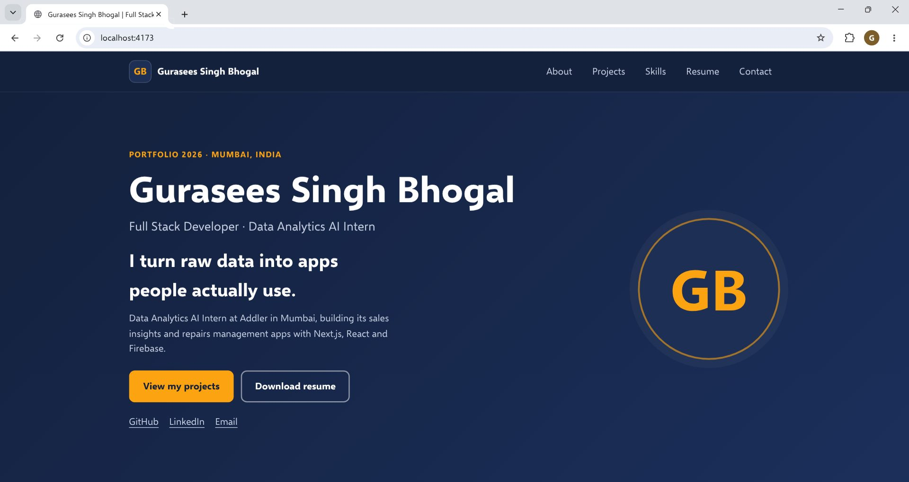
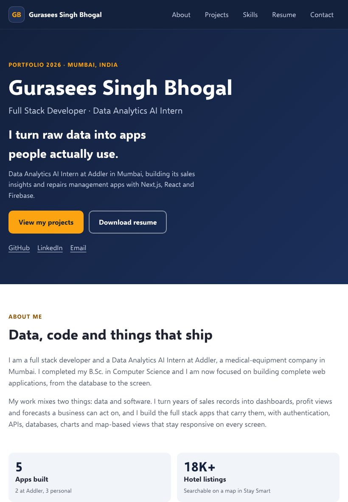
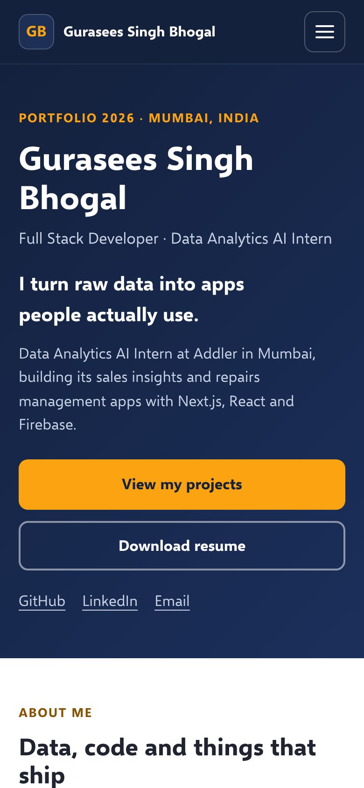
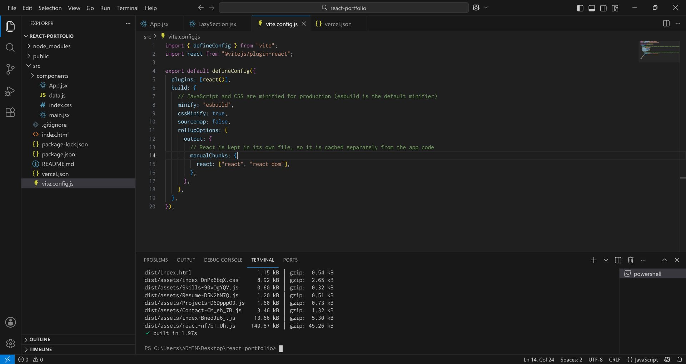

# Gurasees Singh Bhogal - React Portfolio

A responsive portfolio website built with React and Vite. It has five sections (About Me, Projects, Skills, Resume and Contact), loads the lower sections and the project images only when they are needed, and is built for production with minified JavaScript and CSS.

- Live website: `ADD THE VERCEL LINK HERE AFTER DEPLOYING`
- Custom domain: `ADD THE DOMAIN HERE (optional)`
- GitHub repository: `ADD THE REPOSITORY LINK HERE`

> The live website, the custom domain and the repository link depend on the account that deploys the project, so they are left for the owner to fill in. Everything else in this file describes what was built and tested.



## 1. Tech stack

| Part | Choice |
| --- | --- |
| Library | React 18 (function components and hooks) |
| Build tool | Vite 5 with `@vitejs/plugin-react` |
| Styling | Plain CSS with variables, grid, flexbox and `clamp()` |
| Hosting | Vercel (steps below) |

There are no UI libraries. The whole app is two runtime dependencies: `react` and `react-dom`.

## 2. Running it

```bash
npm install
npm run dev        # development server at http://localhost:5173
npm run build      # production build into dist/
npm run preview    # serve the production build at http://localhost:4173
```

## 3. Project structure

```
react-portfolio/
  public/                     files copied as they are
    favicon.svg
    robots.txt
    projects/*.svg            project cover images (replace with real screenshots)
    Gurasees_Singh_Bhogal_Resume.pdf
  src/
    main.jsx                  entry point
    App.jsx                   page layout and the lazy imports
    data.js                   all the text of the portfolio in one place
    index.css                 all the styles
    components/
      Header.jsx              sticky header, mobile menu, active link
      Hero.jsx  About.jsx  Footer.jsx
      Projects.jsx  ProjectCard.jsx   filterable project cards
      Skills.jsx  Resume.jsx  Contact.jsx
      LazySection.jsx         loads a section when it is near the screen
      useActiveSection.js     highlights the nav link of the visible section
  docs/screenshots/           screenshots used in this file
  vite.config.js  vercel.json  index.html  package.json
```

To change the content (name, projects, skills, experience), edit `src/data.js`. The components do not need to change.

## 4. Sections

1. **About Me** - short introduction, four key numbers and three "roles" cards.
2. **Projects** - six project cards with filter buttons (All, Internship, Personal, Team).
3. **Skills** - grouped skill chips.
4. **Resume** - experience and education timelines, certifications and a download button for the resume PDF.
5. **Contact** - contact details with a copy-email button and a message form.

The contact form is checked in the browser (name, a valid email, and a message of at least 10 characters). There is no server, so a valid message opens the visitor's email app through a `mailto:` link with the message ready to send. If you later want messages delivered without the visitor's email app, connect the form to a service such as Formspree or a Vercel serverless function.

## 5. Responsive design

- One stylesheet, mobile-friendly grids that use `auto-fit`/`minmax`, and fluid text sizes with `clamp()`.
- Breakpoints at 900px, 760px and 380px. Below 760px the navigation turns into a hamburger menu (`aria-expanded` is kept up to date).
- The sticky header is allowed for with `scroll-padding-top`, so a section is never hidden under it after clicking a link.
- Accessibility: a skip link, visible focus outlines, semantic landmarks, labelled form fields with error messages, and `prefers-reduced-motion` support.

| Tablet (820 x 1180) | Phone (390 x 844) |
| --- | --- |
|  |  |

## 6. Performance work

### Lazy loading of components

`Projects`, `Skills`, `Resume` and `Contact` are imported with `React.lazy`. A small `LazySection` component wraps each one. It shows an empty placeholder (with the section id and a minimum height) and uses an `IntersectionObserver` with a `400px` margin, so the code for a section is downloaded just before the visitor reaches it.

```jsx
const Projects = lazy(() => import("./components/Projects.jsx"));
...
<LazySection id="projects" component={Projects} minHeight={900} />
```

### Lazy loading of images

Every project image uses the browser's native lazy loading, with `width` and `height` so the space is reserved and the page does not jump:

```jsx

```

Because the Projects section itself is lazy, no project image is requested when the page first opens.

### Minified files

`npm run build` minifies the JavaScript (esbuild) and the CSS, and React is placed in its own file so that the browser can cache it separately. `vercel.json` gives the hashed files in `/assets` a one-year immutable cache.

```
dist/index.html                     1.15 kB | gzip:  0.54 kB
dist/assets/index-DnPx6bqX.css      8.92 kB | gzip:  2.65 kB
dist/assets/Skills-90vOgYQV.js      0.60 kB | gzip:  0.32 kB
dist/assets/Resume-D5K2hN7Q.js      1.20 kB | gzip:  0.51 kB
dist/assets/Projects-D6DpppO9.js    1.60 kB | gzip:  0.73 kB
dist/assets/Contact-CM_eh_7B.js     3.46 kB | gzip:  1.32 kB
dist/assets/index-BnedJu6j.js      13.66 kB | gzip:  5.30 kB
dist/assets/react-nf7bT_Uh.js     140.87 kB | gzip: 45.26 kB
```

The first screen needs only the HTML, one CSS file and two JavaScript files (about 53 kB gzipped in total, most of it React).



## 7. Production build checks

The production build was served with `npm run preview` and tested with Playwright (Chromium) and Lighthouse. Results from that run:

| Check | Result |
| --- | --- |
| First load requests | only the HTML, CSS, `index` and `react` files; 0 project images; no Projects/Skills/Resume/Contact code |
| Scrolling down | the Projects code and images, and then the other sections, are downloaded when they get near the screen |
| Navigation links | all five links land exactly under the sticky header and highlight the right link |
| Project filters | All 6, Internship 2, Personal 3, Team 1 |
| Contact form | 3 errors on an empty submit; invalid email and short message rejected; valid submit shows the success message and clears the form |
| Copy email button | copies the address to the clipboard |
| Resume download | `200`, `application/pdf` |
| Mobile menu | opens, closes after choosing a link, `aria-expanded` updates |
| Horizontal overflow | none at 320, 360, 390, 768, 1024, 1280 and 1920 px |
| Console and network | no console errors or warnings, no 4xx/5xx responses |
| Lighthouse (mobile) | Performance 100, Accessibility 100, Best Practices 100, SEO 100 |
| Lighthouse (desktop) | Performance 100, Accessibility 100, Best Practices 100, SEO 100 |

Lighthouse was run against `localhost` with its simulated throttling, so the timings are a guide. Run it again against the deployed site (Chrome DevTools > Lighthouse) and record the real numbers.

## 8. Deploying to Vercel

1. Create a new empty repository on GitHub (for example `react-portfolio`) and push this project:
   ```bash
   git init
   git add .
   git commit -m "React portfolio"
   git branch -M main
   git remote add origin https://github.com/<your-username>/react-portfolio.git
   git push -u origin main
   ```
2. Sign in at https://vercel.com with your GitHub account and choose **Add New > Project**.
3. Import the repository. Vercel detects Vite. Check these settings:
   - Framework preset: **Vite**
   - Build command: `npm run build`
   - Output directory: `dist`
4. Click **Deploy**. Every later `git push` to `main` deploys again automatically, and every branch gets its own preview link.
5. Copy the `https://<project>.vercel.app` link into the top of this file.

Netlify and GitHub Pages also work. Use the same build command and the `dist` folder. For GitHub Pages add `base: "/react-portfolio/"` to `vite.config.js`.

### Custom domain and SSL

1. Buy or use a domain, then open the project in Vercel: **Settings > Domains > Add**.
2. Enter the domain (for example `guraseesbhogal.com`). Vercel shows the DNS records to add at your domain provider: an `A` record for the apex domain and a `CNAME` for `www`.
3. Wait for DNS to update (usually minutes, sometimes a few hours). Vercel then issues and renews the SSL certificate on its own, so the site opens over `https://` without any extra step.
4. Choose whether `www` redirects to the main domain (or the other way round) in the same screen.

## 9. Testing after deployment (checklist)

Cross-browser. Open the deployed link in each and go through the same list: menu, all five sections, project filters, contact form, copy button, resume download.

- [ ] Chrome (Windows)
- [ ] Microsoft Edge
- [ ] Firefox
- [ ] Safari (Mac or iPhone)
- [ ] Chrome on Android

Devices. Use Chrome DevTools device mode, then one real phone if you can.

- [ ] 360 x 740 (small Android)
- [ ] 390 x 844 (iPhone)
- [ ] 820 x 1180 (tablet)
- [ ] 1366 x 768 (small laptop)
- [ ] 1920 x 1080 (desktop)

Also check: the `https://` padlock, that `www` and the non-`www` address both work, the resume link, and a Lighthouse run on the live address.

## 10. Challenges and how they were handled

| Challenge | Solution |
| --- | --- |
| A nav link such as "Contact" could land in the wrong place, because sections below the screen are not loaded yet and have no height. | Each lazy section has a placeholder that carries the section `id` and a minimum height, and a small `Landed` component scrolls to the section once it has loaded. `overflow-anchor: none` stops the browser from shifting the page while sections mount. |
| The page could shift when a section replaces its placeholder. | Placeholders use a minimum height close to the real height, and images have `width` and `height`. Lighthouse reports a layout shift of 0. |
| Highlighting the right menu link while the visitor scrolls, without a wrong link showing at the very top. | An `IntersectionObserver` hook starts with no active link and sets one only when a section is actually in view. |
| The sticky header covered the top of a section after clicking a link. | `scroll-padding-top` on the page, equal to the header height. |
| The contact form has no backend. | Validate in the browser and send with `mailto:`. Clearly noted above, with the upgrade path (Formspree or a serverless function). |
| Low colour contrast on small amber headings on a white background (Lighthouse accessibility 95). | A darker amber (`#8a5200`, contrast 6.4:1) is used for text on light backgrounds. The bright amber stays for buttons and the dark hero. Accessibility is now 100. |
| Long caching must not show old files after a new deploy. | Vite puts a hash in every file name, so a changed file always has a new name, and only those files are cached for a year. |

## 11. Things to do before sharing

- Replace the generated cover images in `public/projects/` with real screenshots of your projects (keep the same names, or update `cover` in `src/data.js`).
- Add the live links of the projects that are deployed.
- Fill in the three links at the top of this file.

## Licence

Personal portfolio. The code may be used as a reference; the content (text, name, projects) belongs to Gurasees Singh Bhogal.
